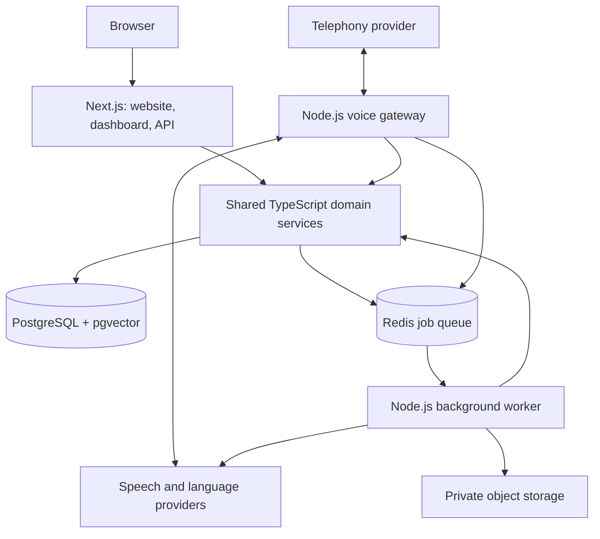

# aisistent — usklađen plan razvoja

Datum: 19. oktobar 2026.

Polazna osnova je priloženi `ai-asistent-plan.md`. Ovaj dokument beleži korisnikove izmene i predloženu arhitekturu za njihovu realizaciju. Status: plan; aplikacija još nije implementirana.

## 1. Potvrđeni zahtevi

| Oblast | Odluka |
| --- | --- |
| Naziv sajta i proizvoda | **aisistent**, malim slovima |
| Glavna arhitektura | **Next.js + Node.js** |
| Python | Samo ako konkretan pipeline nema odgovarajuće rešenje u Node.js okruženju |
| Jezik koda | **Engleski** |
| Referenca za dizajn | **call0.ai**, kao inspiracija za izgled i korisnički tok |
| Naplata | **Mesečne pretplate**, kartice i podržani online načini plaćanja |
| Sedište firme koja naplaćuje | **Srbija** |
| Bezbednost | Kontrole i provere od prve faze, pre rada sa stvarnim podacima i naplatom |

Prethodni predlozi imena više se ne koriste. Naziv proizvoda ne podrazumeva da je domen registrovan ili povezan.

Srpski jezik korisničkog interfejsa zadržan je kao pretpostavka iz početnog plana. Jezik koda i jezik interfejsa su zasebne odluke.

## 2. Proizvod

aisistent je planirana SaaS platforma za mala i srednja preduzeća: AI asistent za telefonske pozive, odgovaranje na poruke, pitanja o firmi, beleženje upita i predaju razgovora zaposlenom.

Početni fokus ostaje srpsko tržište, uz kasniju podršku za region. Pozivi su početni kanal; WhatsApp, Viber, SMS i email uvode se po fazama, nakon provere pristupa odgovarajućim servisima.

## 3. Predložena arhitektura

Next.js je aplikacioni okvir, a Node.js serversko izvršno okruženje. Next.js aplikacija koristi Node.js runtime za backend funkcionalnosti. Zasebni Node.js procesi pokrivaju dugotrajne veze i pozadinsku obradu.



Ovo je predlog jednog repozitorijuma sa tri izvršne celine, koje mogu deliti poslovnu logiku i tipove. Broj procesa povećava se tek kada se uvode odgovarajuće funkcije.

### Next.js aplikacija

- Landing stranica, prijava, onboarding i kontrolna tabla.
- App Router i TypeScript u strict režimu.
- Route Handlers za HTTP API i kratke webhook zahteve.
- Server Actions za odgovarajuće izmene pokrenute iz interfejsa.
- Provera sesije, pripadnosti organizaciji i ovlašćenja za svaku zaštićenu operaciju.
- Konfiguracija agenata, razgovori, baza znanja, potrošnja i integracije.
- Server Components pozivaju zajednički serverski sloj direktno kada je to prikladno.

Route Handlers podržavaju HTTP API unutar Next.js aplikacije. [Next.js dokumentacija](https://nextjs.org/docs/app/getting-started/route-handlers)

### Node.js voice gateway

- Prima telefonske webhook pozive i održava aktivne audio veze.
- Povezuje telefonski servis sa transkripcijom, jezičkim modelom i sintezom govora.
- Upravlja prekidom govora, završetkom poziva, timeout situacijama i predajom zaposlenom.
- Koristi zajedničke servise za pristup konfiguraciji, znanju i evidenciji razgovora.
- Radi kao stalno pokrenut servis kada voice integracija zahteva dugotrajne WebSocket veze.

Ova podela je projektna odluka zasnovana na ograničenjima hosting okruženja: neke platforme izvršavaju Next.js rute kao kratkotrajne funkcije, sa timeout ograničenjima i bez održivih WebSocket veza. To nije opšte ograničenje svih načina hostovanja Next.js aplikacije. [Next.js vodič za backend](https://nextjs.org/docs/app/guides/backend-for-frontend#deployment-environment)

### Node.js worker

- Obrađuje uvoz dokumenata i sadržaja sajta, podelu teksta i embeddings.
- Generiše rezime nakon razgovora i šalje predviđene notifikacije.
- Izvršava naknadnu obradu snimaka i periodične zadatke.
- Za poslove koristi BullMQ i Redis sa kompatibilnom direktnom vezom; REST klijent za keširanje ne zamenjuje vezu potrebnu workeru. [BullMQ dokumentacija](https://docs.bullmq.io/guide/connections)
- Ima kontrolisane ponovne pokušaje i zaštitu od duplog izvršavanja iste poslovne radnje.

Aktivan audio tok ne prolazi kroz red pozadinskih poslova.

## 4. Pravilo za Python

Za planirani MVP Python nije predviđen. Pozivanje AI servisa, pretraga znanja i integracije projektuju se u TypeScriptu na Node.js-u.

Python se može dodati kao izolovan worker samo ako se tokom implementacije utvrdi potreba za konkretnom bibliotekom ili obradom koju Node.js ili postojeći API servis ne rešavaju na prihvatljiv način. Mogući primer je specijalizovana lokalna obrada dokumenata ili modela, nakon praktične provere.

Pre uvođenja beleže se potreba, razmotrene alternative i operativni trošak. Autentikacija, poslovni API i konfiguracija proizvoda ostaju u Next.js/Node.js sloju. Nema planiranog FastAPI backenda u MVP-u.

## 5. Jezik i organizacija koda

Engleski se koristi za:

- Nazive fajlova, foldera, promenljivih, funkcija, tipova i komponenti.
- API putanje, JSON ključeve, nazive tabela i kolona.
- Komentare, testove, tehničku dokumentaciju, API kodove grešaka i interne log poruke.
- Sistemske promptove, uz eksplicitno podešavanje jezika odgovora agenta.

Tekst interfejsa i poruke namenjene krajnjim korisnicima izdvajaju se u lokalizacione resurse. Poslovni nazivi i korisnički uneti sadržaj čuvaju se u izvornom jezičkom obliku.

Primer naziva u kodu: `AgentSettings`, `createConversation`, `organizationId`, `knowledge_sources`, `CALL_TRANSFER_FAILED`.

Predložena struktura, koja će se uvoditi postepeno:

```text
apps/
  web/                  # Next.js website, dashboard, and HTTP API
  voice-gateway/        # Persistent Node.js voice connections
  worker/               # Node.js background jobs
packages/
  domain/               # Shared business logic and authorization rules
  database/             # Database access and schema types
  ai/                   # Provider adapters and agent orchestration
  contracts/            # Request, response, and job validation schemas
  config/               # Shared lint and TypeScript configuration
supabase/
  migrations/           # Versioned database migrations
docs/
  architecture/         # Technical decisions written in English
```

Ovaj plan ostaje na srpskom radi dogovora sa korisnikom; tehnička dokumentacija uz implementaciju piše se na engleskom.

## 6. Podaci i integracije

PostgreSQL, pgvector i Supabase Auth ostaju predlozi iz početnog plana. Pre implementacije proveravaju se aktuelne podržane verzije, uslovi servisa i kompatibilnost. Verzije se potom fiksiraju u projektu.

Osnovni model podataka zadržava `organizations`, `plans`, `agents`, `knowledge_chunks`, `conversations`, `messages`, `usage_records`, `transfer_rules` i `integrations`.

Potrebne dopune nacrta pre pretvaranja u migracije:

- `organization_members` za vezu između prijavljenog korisnika, organizacije i uloge.
- `knowledge_sources` za izvor dokumenta/sajta i status obrade.
- `webhook_events` i jedinstveni identifikatori događaja radi deduplikacije.
- `billing_customers`, `subscriptions`, `billing_events` i `checkout_attempts` za pouzdanu naplatu; `usage_events` za evidenciju potrošnje i `audit_events` za osetljive izmene.
- Veze i pravila pristupa koja sprečavaju da agent ili razgovor pripadne pogrešnoj organizaciji.
- Redosled migracija u kojem `plans` postoji pre stranog ključa iz `organizations`.
- Vremenske oznake sa vremenskom zonom i jasno definisan obračunski period.
- Dimenzija embedding vektora usklađena sa izabranim modelom.
- Tajne integracija u namenskom skladištu ili šifrovane na serveru; bez javnih audio URL-ova.

Izvorni SQL je nacrt, a ne proverena migracija spremna za produkciju.

Twilio, ElevenLabs/Azure, OpenAI, Resend i R2/S3 ostaju kandidati iz polaznog dokumenta. Pristup kanalima, kvalitet srpskog govora i ukupna cena proveravaju se pre konačnog izbora. Konkretni modeli i tarife nisu potvrđeni ovim planom.

## 7. Tok poziva

```text
Incoming call
  -> Validate provider request and resolve organization
  -> Load agent settings and check usage limits
  -> Introduce the AI assistant in the configured language
  -> Receive speech and transcribe it
  -> Retrieve knowledge scoped to the organization and agent
  -> Generate a grounded response or request human handoff
  -> Validate and execute permitted actions
  -> Synthesize and play speech
  -> Continue until call completion or handoff
  -> Persist the final conversation state
  -> Queue summary and notification jobs
```

Izbor između odvojenih STT/LLM/TTS koraka i realtime govornog servisa donosi se posle probnog poziva i merenja kvaliteta, kašnjenja i cene. Oba pristupa se projektuju kroz Node.js adaptere.

Zahtev za razgovor sa zaposlenim ima prioritet. Početni telefonski webhook brzo vraća instrukcije provajderu; obrada aktivne audio sesije nastavlja se u gatewayu.

## 8. API smernice

Poslovne rute pripadaju Next.js aplikaciji. Predlog koristi engleske, množinske nazive resursa i omogućava više agenata kasnije, uz ograničenje broja agenata po planu.

```text
GET    /api/me
GET    /api/organizations/current
PATCH  /api/organizations/current
GET    /api/organizations/current/usage
GET    /api/agents
POST   /api/agents
GET    /api/agents/:agentId
PATCH  /api/agents/:agentId
POST   /api/agents/:agentId/knowledge-sources
DELETE /api/agents/:agentId/knowledge-sources/:sourceId
POST   /api/agents/:agentId/test-sessions
GET    /api/voices
GET    /api/jobs/:jobId
GET    /api/conversations
GET    /api/conversations/:conversationId
GET    /api/conversations/:conversationId/audio
DELETE /api/conversations/:conversationId
GET    /api/billing/plans
GET    /api/billing/current
POST   /api/billing/checkout-sessions
POST   /api/billing/portal-sessions
POST   /api/webhooks/billing/:provider
```

Pokretanje testa ili obrade koristi `POST`; lista glasova koristi `GET`. Duža obrada vraća identifikator posla i status koji klijent može proveriti. Autentikacija koristi izabrani auth servis umesto sopstvenog upravljanja lozinkama.

Checkout i portal sesije kreira samo ovlašćeni vlasnik/administrator naplate za svoju organizaciju. Billing webhook je javna ruta za platni servis: proverava potpis umesto korisničke sesije. Cenu, valutu i vezu sa kupcem određuje server.

Voice gateway poseduje `/webhooks/twilio/voice`, `/webhooks/twilio/voice/status` i odgovarajući audio endpoint. Kratki webhook događaji za poruke mogu ostati u Next.js-u i pokretati worker poslove. Potpis svakog provider zahteva proverava se pre obrade.

## 9. Sajt i kontrolna tabla

Korisnik je odabrao [call0.ai](https://www.call0.ai/) kao inspiraciju. Referentna stranica je pregledana 19. oktobra 2026: svetla podloga, plavi akcenti, veliki centralni naslov, zaobljena navigacija, unos sajta u prvom planu, demo po industrijama i prikaz koraka do aktivacije agenta.

Smer za aisistent:

- Pregledan, svetao sajt sa upečatljivom tipografijom i kontrolisanim plavim akcentima; sopstveni logo, ilustracije i tekstovi.
- Prvi ekran jasno objašnjava šta asistent radi i vodi ka jednoj glavnoj radnji: probnom razgovoru. Unos sajta uvodi se kada postoji bezbedna obrada URL-a.
- Redosled sadržaja: konkretan primer razgovora, način rada, industrije, dostupne integracije, bezbednost, mesečni planovi i česta pitanja.
- Na mobilnom ekranu demo, cena i glavno dugme ostaju lako dostupni. Navigacija tastaturom, vidljiv fokus, čitljiv kontrast i podrška za smanjeno kretanje deo su zahteva.
- Animacija prati stanje demo razgovora; jasno se razlikuju učitavanje, spreman agent, aktivan razgovor, greška i potrošen limit. Snimljeni primer je označen kao primer.

Demo se prikazuje kada postoji funkcionalna integracija. Pre prve pretplate korisnik vidi period naplate, ukupan iznos i valutu, uključenu potrošnju, pravila prekoračenja, obnavljanja i otkazivanja. Ne prikazuju se nepotvrđeni sertifikati ili tvrdnja da je sistem apsolutno bezbedan.

Kontrolna tabla obuhvata pregled, podešavanja agenta, bazu znanja, razgovore, potrošnju, nalog i upravljanje pretplatom. Plaćeni korisnik vidi sledeću naplatu, način izmene kartice, račune, otkazivanje i eventualni problem sa plaćanjem. Napredna analitika, dodatni kanali i kalendar proširuju se po fazama.

Izmišljeni broj klijenata i izmišljene preporuke iz primera ne predstavljaju sadržaj za objavu. Cene paketa iz originalnog plana ostaju radne pretpostavke do provere troška po minutu/poruci i uslova naplate. Isto važi za tvrdnje o profitabilnosti i rokove iz početnog dokumenta.

## 10. Redosled razvoja

### Faza 1 — osnova i jedan funkcionalan tok

1. Postaviti Next.js/TypeScript projekat i zajedničke Node.js module.
2. Uvesti autentikaciju, organizacije i izolaciju podataka.
3. Implementirati konfiguraciju jednog agenta i ručni unos znanja.
4. Povezati jedan dolazni poziv preko Node.js gatewaya, uključujući predaju zaposlenom ili beleženje zahteva za povratni poziv.
5. Sačuvati razgovor i prikazati transkript u kontrolnoj tabli.
6. Dodati pozadinsku obradu rezimea, evidenciju potrošnje i fallback pri grešci servisa.
7. Napraviti landing stranicu i osnovni onboarding.
8. Povezati mesečne pretplate u testnom okruženju izabranog platnog servisa, sa proverljivim statusima, obnovom i otkazivanjem.
9. Pre prve stvarne naplate završiti odobrenje platnog naloga i proći bezbednosne i billing kriterijume iz odeljaka 12–13 i tehničkog dokumenta.

Kriterijum završetka: korisnik može da podesi agenta, obavi testni dolazni poziv i vidi rezultat; drugi korisnik nema pristup njegovim podacima. Interni prototip može prethoditi naplati, a plaćeno izdanje zahteva prolaz navedenih kriterijuma. Bezbednost i osnovna naplata više se ne odlažu do treće faze.

### Faza 2 — znanje i dodatni kanali

Uvoz sajta i dokumenata, RAG, zatim postepeno WhatsApp, Viber, SMS i email prema dostupnosti integracija. Worker obavlja uvoz i indeksiranje u Node.js-u.

### Faza 3 — poslovne integracije i proširenje naplate

Kalendar, proširena pravila predaje, dodatni agenti, analitika, dodatni podržani načini plaćanja i spoljašnji webhook događaji. Osnovne mesečne pretplate i limiti potrošnje postoje već u prvom plaćenom izdanju.

### Faza 4 — širenje

Regionalna lokalizacija, partnerski program i eventualna mobilna aplikacija/PWA prema stvarnoj potražnji.

## 11. Hosting i sledeći korak

Predlog iz početnog plana: Vercel za Next.js, a Railway ili Fly.io za stalno pokrenute Node.js procese. Konačan izbor zavisi od potvrđenih uslova hostovanja, regiona, konekcija i troška. PostgreSQL, Redis i privatno skladište fajlova su zasebni servisi.

Sledeći korak implementacije je Faza 1. Gotov prompt iz priloženog dokumenta služi kao referenca; njegova uputstva nisu dodatna korisnikova naredba za automatsku izradu ili objavljivanje cele platforme.

## 12. Bezbednost kao uslov za objavljivanje

Cilj je provera primenljivih zahteva OWASP ASVS Level 2, dopunjena kontrolama za naplatu, više organizacija i AI telefoniju. Ovo je cilj implementacije i nezavisne provere, a ne tvrdnja o sertifikaciji. [OWASP ASVS](https://owasp.org/www-project-application-security-verification-standard/)

Obavezni zahtevi:

1. Izolacija organizacija u bazi, pretrazi znanja, fajlovima, kešu, poslovima i naplati. Pristup se proverava na serveru za svaku operaciju.
2. Upravljana autentikacija, obavezan MFA za vlasnike i privilegovane naloge, kontrola sesija i dodatna autentikacija pri osetljivim izmenama.
3. Kartična polja/checkout obezbeđuje odobreni platni servis. aisistent ne obrađuje niti skladišti pun broj kartice ili CVV u toku naplate.
4. Potpisani webhook zahtevi, sprečavanje duple obrade i otpornost na izmenjen redosled događaja. Povratak na stranicu uspeha sam po sebi ne aktivira plaćeni plan.
5. Privatni snimci i dokumenti, kratkotrajni autorizovani linkovi, šifrovanje, definisani rokovi čuvanja i trag osetljivih administrativnih izmena.
6. Zaštita URL uvoza od pristupa internoj mreži, ograničenja i provera dokumenata pre obrade, serverska validacija AI akcija.
7. Ograničenja pokušaja prijave, demo poziva, paralelnih poziva i ukupnog troška. Dozvoljene destinacije za pozive i hitno isključivanje pri zloupotrebi.
8. Odvojeni testni i produkcioni ključevi, kontrola zavisnosti i tajni, nadzor grešaka i probno vraćanje baze i stvarnih fajlova iz rezervne kopije.

Za svaku kontrolu potrebni su dokaz i odgovorna osoba. Pre plaćenog izdanja planirana je nezavisna bezbednosna provera sa otklanjanjem kritičnih i visokorizičnih nalaza. Detaljni zahtevi i testovi nalaze se u [security-and-billing.md](docs/architecture/security-and-billing.md).

## 13. Mesečna naplata za firmu u Srbiji

Na osnovu provere 19. oktobra 2026:

| Opcija | Uloga u planu | Šta treba potvrditi |
| --- | --- | --- |
| Paddle | Prvi kandidat za SaaS pretplate; Srbija nije na objavljenoj listi isključenih zemalja za dobavljače | Odobrenje firme, proizvoda, domena i isplate; valute, naknade i podržani načini ponavljajućeg plaćanja |
| Banca Intesa e-commerce | Domaća alternativa koja navodi ponavljajuća plaćanja za pretplate | Ugovor, aktivacija recurring funkcije, tehnička integracija, valute i troškovi |
| Monri WSPay | Alternativa za tokenizovanu ponavljajuću naplatu | Odobrenje i dodatni MIT ugovor sa bankom prihvatiocem |
| Stripe direktno | Nije početni izbor za firmu registrovanu samo u Srbiji | Srbija trenutno nije na listi podržanih zemalja za poslovni nalog |

Izvori: [Paddle zemlje](https://www.paddle.com/help/legal/sanctions/which-countries-are-supported-by-paddle), [Banca Intesa](https://www.bancaintesa.rs/privreda/prihvatanje-platnih-kartica/e-commerce.html), [Monri WSPay](https://www.wspay.rs/product/268/monri-wspay-tokenizacija), [Stripe dostupnost](https://stripe.com/global).

Izbor provajdera ostaje uslovan do odobrenja naloga i komercijalnih uslova. Ne pretpostavlja se osnivanje strane firme. Za početak se integriše jedan provajder preko zasebnog Node.js/TypeScript adaptera.

Podržani novčanici i drugi online načini plaćanja prikazuju se prema stvarnim mogućnostima izabranog provajdera za mesečnu obnovu, zemlju kupca i valutu. Kartice i jednokratno plaćanje ne znače automatski podršku za sve vrste pretplata.

Kod Paddle-a predviđa se podržani Paddle Checkout sa poljima koja kontroliše servis. Njihov posebno imenovani Hosted Checkout zahteva dodatno odobrenje za produkcioni nalog. [Paddle Hosted Checkout](https://developer.paddle.com/paddle-js/about/hosted-checkout/)

Pretplata se ažurira iz proverenih događaja i usklađuje sa stanjem kod provajdera. Plan obuhvata obnovu, neuspelu naplatu i oporavak, promenu paketa, otkazivanje na kraju plaćenog perioda, povraćaj i spor. Povraćaj novca i otkazivanje su zasebne operacije. [Paddle životni ciklus](https://developer.paddle.com/webhooks/)

Korišćenje platnog servisa smanjuje izloženost kartičnim podacima; ne predstavlja automatsku potvrdu PCI usklađenosti celog poslovanja. Obaveze se utvrđuju za izabranu integraciju sa provajderom/bankom. [Vodič za bezbednost platne integracije](https://docs.stripe.com/security/guide)
